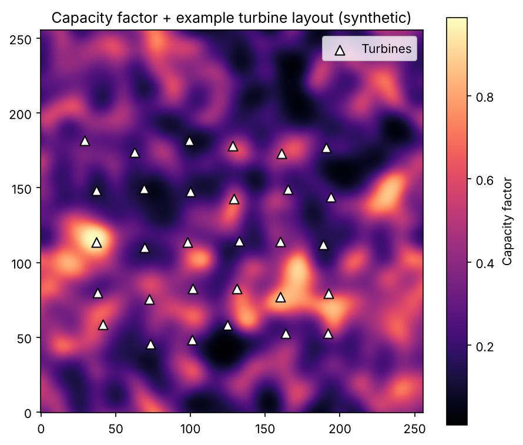

# test-dg-2

[](https://colab.research.google.com/github/studiorabota/test-dg-2/blob/main/notebooks/windkit_demo.ipynb)

Test repo: a notebook that opens in Google Colab, imports a local Python package (`windkit`), and loads data and images stored with **Git LFS**.



```
.
├── .gitattributes             # *.npy, *.png, *.jpg … → Git LFS
├── data/
│   └── wind_speed_field.npy   # synthetic (24 h × 256 × 256) wind field, ~6 MB, LFS
├── images/                    # PNGs, LFS
│   ├── power_curve.png
│   ├── turbine_layout.png
│   └── wind_map.png
├── notebooks/
│   └── windkit_demo.ipynb     # clones the repo, pulls LFS, imports windkit
├── windkit/                   # local Python package
│   ├── __init__.py
│   ├── io.py                  # load_field, is_lfs_pointer
│   ├── stats.py               # summary, power_curve, capacity_factor
│   └── plotting.py            # plot_mean_field, plot_timeseries
├── push.sh
└── requirements.txt
```

## Publish

Use the command line, not the GitHub upload page: the upload page skips `.gitattributes`, so nothing ends up in LFS.

1. On GitHub, create a new **empty** repo named `test-dg-2` under `studiorabota` (don't add a README, .gitignore or license).
2. Install `git-lfs` if you don't have it (`brew install git-lfs`).
3. Run:
   ```bash
   ./push.sh
   ```

## Test

1. On GitHub, `data/wind_speed_field.npy` and the PNGs should show **"Stored with Git LFS"**.
2. Click **Open in Colab** above and choose **Runtime → Run all**.

## How the modules are imported

After cloning, the notebook adds the repo folder to `sys.path`, so `import windkit` works without installing anything. If you change a module and push, re-run the clone cell (it pulls the latest version) and restart the runtime so Python re-imports it.
